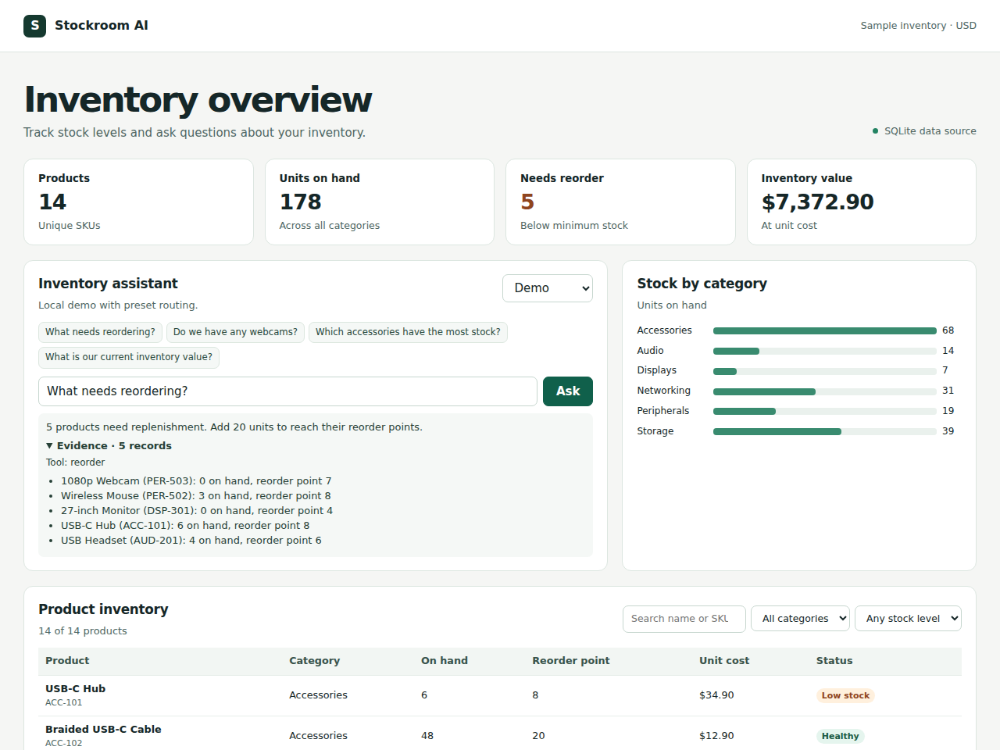

# Stockroom AI

[](https://github.com/opedjfkvos/stockroom-ai/actions/workflows/tests.yml)

Stockroom AI is an AI-assisted portfolio prototype for answering questions about a sample inventory. It includes a browser dashboard, a Python API and a SQLite database. The dashboard opens in Demo mode with no model downloads, API keys, or third-party Python packages.




## Run locally

Use Python 3.10 or newer.

    python app.py

Open http://127.0.0.1:8080. If the port is busy, set a different one with `python app.py --port 8082`.

Try these examples:

| Question | Tool | Expected result |
| --- | --- | --- |
| What needs reordering? | Reorder | 5 products, 20 units needed |
| Do we have any webcams? | Lookup | 0 units for the 1080p Webcam |
| Which accessories have the most stock? | Compare | Braided USB-C Cable, 48 units |
| What is our current inventory value? | Valuation | $7,372.90 |
| Which products are out of stock? | Out of stock | 2 products |

Select **Evidence** after an answer to inspect the tool and records used. The catalogue can also be filtered by name or SKU, category and stock status.

## Run with a local language model

Start Ollama and install the example model.

    ollama pull qwen2.5:1.5b

With Ollama running at its default local address, choose **Local LLM** in the web UI and ask a question. Set the `STOCKROOM_MODEL` environment variable before starting the app to use a different installed Ollama model. Smaller models can misinterpret questions, so use the Evidence panel to check tool selection and filters.

## Evaluate question routing

```sh
python model_eval.py --demo
python model_eval.py --model qwen2.5:1.5b
```

The small 18-question smoke suite checks the documented Demo behavior in CI. The 12-question diagnostic contains paraphrases and out-of-scope requests. The Demo rules for “sold out” and questions of the form “there are any … left” were added after reviewing this set. Its score measures behavior on a partly tuned set and does not estimate generalization. CI gates on the smoke suite. The reported bugs have their own regression tests.

```sh
python model_eval.py --demo --holdout
python model_eval.py --model qwen2.5:1.5b --holdout
```

| Run | Exact plans | Correct tools | Correct filters | Correct refusals | Incorrect refusals on supported requests |
| --- | ---: | ---: | ---: | ---: | ---: |
| Demo, smoke | 18/18 | 14/14 | 14/14 | 4/4 | 0/14 |
| Demo, partly tuned diagnostic | 8/12 | 3/7 | 3/7 | 5/5 | 4/7 |
| qwen2.5:1.5b | Pending | — | — | — | — |

Tool and filter accuracy use all supported questions as their denominator. A refusal scores zero on both. Filters are scored independently of the tool, and product keywords are equivalent if they match the same sample SKUs. The live command sends prompts directly to Ollama so it measures the model's choices, including requests the app can reject before contacting the model. See [model_eval.py](model_eval.py) for the questions and scoring rules.

## How a question is answered

1. A question enters `POST /api/ask`.
2. Demo mode selects a tool using deterministic rules. Local LLM mode asks Ollama for a JSON object that identifies a tool and optional filters.
3. Python validates the tool and filters. Unsupported requests return a help message before any inventory tool runs.
4. SQLite runs the selected query with bound parameters. The connection is read-only after the initial seed.
5. Python calculates or summarizes the result using the returned records. The model does not generate SQL or inventory quantities.

The API exposes `GET /api/inventory` for the catalogue and dashboard metrics. It exposes `POST /api/ask` with JSON fields `question` and `mode` (`demo` or `ollama`) for the assistant. The server binds to localhost. Demo mode accepts one product or category scope per question, and asks you to split compound requests.

## SQLite schema

On first use the app applies [schema version 1](sql/schema.sql) and seeds a local SQLite file at `data/stockroom.sqlite3`. Set `STOCKROOM_DB` to select a different file. The schema separates categories, products and signed stock movements. The `inventory_status` view joins the catalogue with aggregated movements, so a product with no movements has zero on-hand stock. Foreign keys are enforced during initialization, and indexes support category and movement lookups. App queries open the database read-only.

[Example SQL reports](sql/reports.sql) summarize stock value and replenishment costs by category. The app calculates dashboard totals in SQLite.

## Verify

    python -m unittest discover -s tests -v

Tests cover Demo routing, stock and price calculations, the real `POST /api/ask` endpoint, and persistence and read-only access in SQLite. The SQL reports are reconciled with the dashboard and reorder query. The movement test records a delivery and dispatch and checks the resulting balances and statuses. Separate tests exercise the Ollama client against a stub server. Live-model quality is measured by the standalone evaluation when Ollama is available.

The GitHub Actions workflow is configured to run the unit tests and the Demo evaluation on Python 3.10 and 3.12.

## Files

- `app.py` serves the client and the JSON endpoints.
- `inventory.py` initializes SQLite and implements the five inventory tools.
- `sql/` contains the schema and reporting queries.
- `assistant.py` routes demo requests and validates Ollama plans.
- `static/` contains the dashboard.
- `tests/` contains the regression checks.

This prototype was prepared with AI assistance for portfolio review and practice. The inventory is synthetic.

Distributed under the [MIT License](LICENSE).
